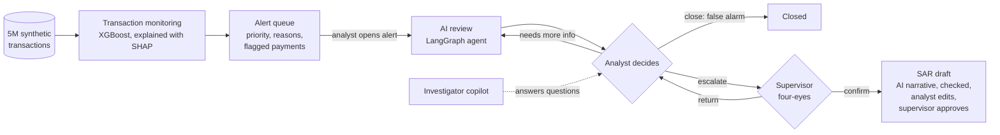
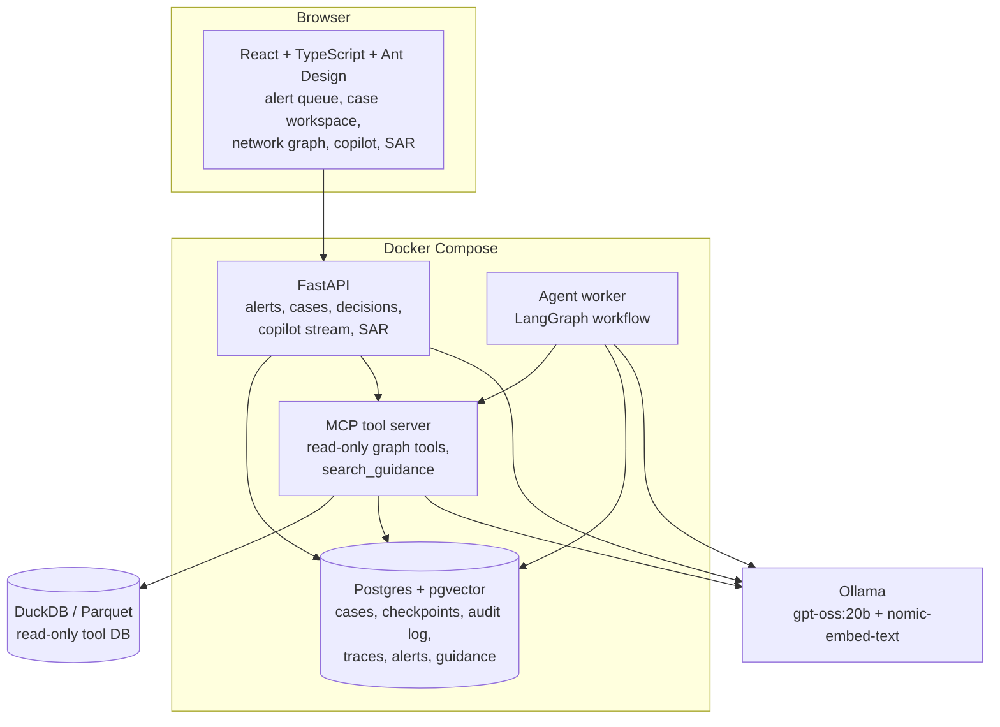

# AML Investigation Agent

[](https://github.com/sehaj-deep/aml-investigation-agent/actions/workflows/ci.yml)

An AI-assisted anti-money-laundering (AML) case manager, built the way a bank's financial-crime team works. Transaction monitoring raises alerts, an AI agent investigates each alert and drafts a recommendation, and human analysts decide under a four-eyes rule. Escalated cases get a suspicious activity report (SAR) draft. Every AI claim is checked against the data or the cited guidance, and every step is recorded in a tamper-evident audit log.

> **Sandbox.** Everything runs on IBM's **synthetic** AMLworld dataset (HI-Small). Nothing here is a production AML system, and results on synthetic data do not show performance on real bank data. Nothing is ever filed with any authority.

## What it does



1. **Detection.** An open-source XGBoost model scores every payment, using the payment itself and both accounts' behavior. An account with a suspicious payment becomes an alert, with a priority band and the top reasons in plain words.
2. **AI review.** The analyst opens an alert and an AI agent investigates it:
   - code first builds a case file: the network, money trails and red flags;
   - the agent checks the account's history and counterparties with read-only tools;
   - it names the suspected typology, collects the supporting transactions, cites public AML guidance, and recommends escalate, close or needs more information.
3. **Human decision.** The analyst closes the case as a false alarm, escalates it, or sends it back. Only a different person with the supervisor role can confirm an escalation; the server enforces this.
4. **SAR draft.** For a confirmed escalation, code assembles the facts and the AI writes the narrative. Every amount and transaction in it is checked; the analyst edits, and a different supervisor approves.
5. **Copilot.** A chat panel answers the analyst's questions with the same read-only tools, streams each lookup, and checks every transaction it cites.

## Results so far

All figures are measured on synthetic data; details and caveats are in [`docs/SCORECARD.md`](docs/SCORECARD.md).

| Area | Result |
|---|---|
| Detection, on IBM's benchmark split | Transaction-level F1 **71.2%**, against 28.7% to 63.2% for the models in the dataset paper. Without the simulator's two shortcuts (payment format, rows after Sep 10): 50.6% |
| Alert policy | Catches **89.4%** of laundering accounts in the test period, at 93.8% false alerts, the range banks run. A below-the-line sample measures what is missed |
| Evidence faithfulness | Every transaction the AI cites is verified against the source data: **288 of 288** injected corruptions caught, no false alarms on 24 clean cases |
| Guidance retrieval (RAG) | Hybrid search puts the right document first **88.9%** of the time, against 77.8% for keywords alone; every quote is checked word for word |
| Tool latency | Read-only graph queries: p95 222 ms in Docker |
| AI analyst accuracy | **Pending.** Measured once, at the end, on a frozen evaluation set of 150 alerts |

## How the AI is kept honest

- **One route to data.** The model reads data only through read-only, bounded MCP tools, and never sees labels. Guidance is searched through a database role that can only read the guidance.
- **Code does what code can.** Code builds the case file, the evidence rows, the SAR facts and every amount. The model reasons and writes.
- **Everything checkable is checked.**
  - Cited transactions are verified against the data.
  - Guidance quotes must appear word for word in their passage.
  - SAR amounts must match the evidence, and the narrative may not claim the report was filed.
- **Humans decide.**
  - No case closes without a recorded decision with a reason.
  - Escalations and SAR approvals need a second person, a supervisor (four-eyes), enforced by the API and the workflow.
- **Full audit trail.** Every model call, tool call, decision and edit is written to an append-only, hash-chained log; Postgres blocks UPDATE, DELETE and TRUNCATE on it. A case can be rebuilt from the log alone.
- **Resilience.**
  - The review is a LangGraph workflow checkpointed in Postgres, so it survives a worker crash.
  - A lost tool connection requeues the case instead of failing it.

## Architecture



The review workflow is a LangGraph state graph:

```
triage -> agent <-> tools -> hypothesize -> collect_evidence -> draft -> verify
             ^                                                            |
             +----------- request_more <-- human_review <-----------------+
                                                |   ^
                                    close       |   | return
                                       v        v   |
                                 finalize <-- supervisor_review (four-eyes)
```

Code steps: triage, collect_evidence, verify, finalize. Model steps: the tool loop, hypothesize, draft. The two review steps pause the graph until a person decides.

## Tech stack

| Layer | Tools |
|---|---|
| Agent | LangGraph, Model Context Protocol (FastMCP), Ollama (gpt-oss:20b, cloud), Pydantic |
| Detection | XGBoost with SHAP explanations, DuckDB features, IBM's 60/20/20 time split |
| Retrieval | Postgres full-text search + pgvector (HNSW), nomic-embed-text (local), reciprocal rank fusion |
| Backend | FastAPI, Postgres 17, psycopg 3, OpenTelemetry traces in Postgres |
| Frontend | React, TypeScript, Vite, Ant Design, Cytoscape.js, TanStack Query, nginx |
| Quality | pytest (unit, golden-number, Docker integration), ruff, pre-commit, GitHub Actions; pip-tools lockfiles with hashes |

## Quick start

Requirements: Python 3.12, Docker Desktop, and [Ollama](https://ollama.com) (signed in, for the cloud model).

```bash
python -m venv .venv
.venv/Scripts/activate                  # Windows; use .venv/bin/activate elsewhere
make install                            # dependencies and pre-commit hooks
cp .env.example .env                    # then set AML_DATA_DIR and the passwords
make convert                            # Parquet tables and the read-only tool DB (about 2 minutes)
pip install --require-hashes -r requirements-detection.txt
python scripts/train_detection.py       # detection model and alert queue (about 12 minutes)
make up                                 # postgres, mcp-graph, api, agent-worker, ui
ollama pull nomic-embed-text
python scripts/build_guidance.py        # public FinCEN and FFIEC guidance into passages
python scripts/load_guidance.py         # embeddings and the read-only guidance role
```

Then open http://127.0.0.1:3000.
- **AI provider:** without a model, set `LLM_PROVIDER=scripted` in `.env` for a deterministic run; set `LLM_PROVIDER=ollama` for the real model.
- **Switching roles:** use the role switch at the top right (Analyst, Supervisor) to try the four-eyes flow. There is no login by design (it is an open sandbox).

Tests: `make test` (what CI runs), `make test-data` (golden numbers on the converted data), `python -m pytest -m docker` (against the running stack).

## Repository layout

```
aml_agent/
  agent/       LangGraph workflow, case file, prompts, copilot, SAR draft
  detection/   account and transaction features, XGBoost model
  tools/       read-only graph tools and the MCP server
  guidance/    hybrid search over public AML guidance
  analysis/    pattern candidates and red-flag rules
  api/, store.py, worker.py, audit.py, verify/
ui/            React case-management app
scripts/       data conversion, detection training, guidance build and load
evals/         evaluation harnesses, alert sets and measured runs
guidance/      guidance passages and their sources (public domain)
docs/          scorecard, roadmap, decision records, findings, threat model
tests/         unit, golden-number and Docker integration tests
```

Design choices and their reasons are recorded in [`docs/decisions/`](docs/decisions/).

## Limitations

- Synthetic data only. Some signals are much cleaner than in real life: most laundering in this simulator uses ACH, and rows after Sep 10 are mostly laundering.
- No customer data exists in the dataset, so SAR narratives identify accounts by bank and account number only.
- The tools see every bank's transactions, which no single real institution can.
- Roles are self-declared (no login): the four-eyes rule is a checked and audited workflow control, not authentication.
- The AI analyst's accuracy is not yet measured; see the scorecard.

See also [`docs/threat_model.md`](docs/threat_model.md).

## Data and licences

- **Transactions.** The dataset is not in this repository. Download "IBM Transactions for Anti-Money Laundering (AML)" from Kaggle, keep only `HI-Small_Trans.csv`, `HI-Small_accounts.csv` and `HI-Small_Patterns.txt`, and set `AML_DATA_DIR` in `.env`. It is published under the Community Data License Agreement, Sharing, Version 1.0 (CDLA-Sharing 1.0). This repository holds code, row-number identifiers and results only.
- **Guidance.** The guidance documents are US government publications in the public domain; see [`guidance/SOURCES.md`](guidance/SOURCES.md).

## Citation

If you use this work, please cite the dataset authors:

- E. Altman, J. Blanusa, L. von Niederhausern, B. Egressy, A. Anghel, K. Atasu. "Realistic Synthetic Financial Transactions for Anti-Money Laundering Models." NeurIPS 2023, Datasets and Benchmarks Track. https://arxiv.org/abs/2306.16424
- B. Egressy, L. von Niederhausern, J. Blanusa, E. Altman, R. Wattenhofer, K. Atasu. "Provably Powerful Graph Neural Networks for Directed Multigraphs." AAAI 2024.
